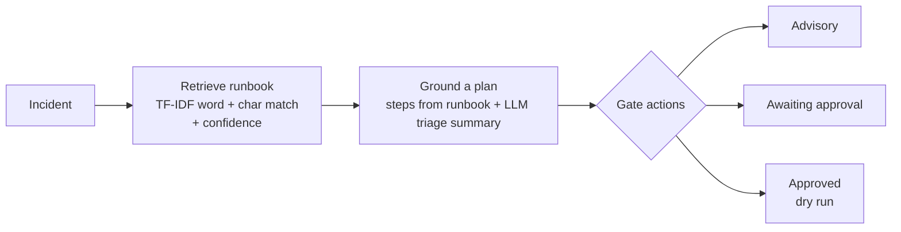

# opspilot

An on-call assistant that triages an incident against a library of **runbooks**.
Given an alert, it retrieves the most relevant runbook, writes a short triage
summary grounded in it, and lays out the runbook's steps — with every
system-changing step gated behind **explicit human approval** and never executed
beyond a dry run. It speeds up the first five minutes of an incident without
taking the human out of the loop.

[](.github/workflows/ci.yml)
[](pyproject.toml)
[](LICENSE)

---

## The shape of the problem

An LLM that freely suggests `kubectl delete` during an outage is a liability: it
can hallucinate a destructive command, and it removes the human judgement that
incident response depends on. opspilot is built around two constraints:

- **Grounded, not invented.** Advice comes from a vetted runbook matched to the
  incident, never from the model's imagination. The model only *summarises* the
  matched runbook; it cannot add steps.
- **Human-in-the-loop for anything that changes the system.** Steps are split
  into advisory (diagnostics, read-only) and actions (they change state). An
  action is only ever marked runnable when a human has explicitly approved its
  index — and even then opspilot performs a **dry run**, never a live command.

## How it works



1. **Retrieve (`runbooks.py`).** TF-IDF + cosine similarity match the incident to
   the most relevant runbook, with a confidence score. Matching is over each
   runbook's **title and symptoms** — what the incident looks like — not its
   remediation steps, and the vectoriser unions a word view (1–2 grams) with a
   character view (`char_wb` 3–5 grams) so an operator's wording ("503s" vs "503")
   still finds the right book. A weak match is flagged `needs_human_triage` rather
   than acted on.
2. **Ground (`assistant.py`).** The plan's steps come from the matched runbook.
   Each step inherits `requires_approval` iff it is an action with a command. An
   LLM writes a two-sentence triage summary grounded in the runbook; offline, an
   extractive summary (title + first step) is used. The summary records its
   `source`.
3. **Gate (`gate.py`).** Given the set of step indices a human has approved, each
   step resolves to **advisory** (nothing to approve), **awaiting_approval** (an
   action not yet approved), or **approved_dry_run** (approved — shown as a dry
   run). This is the entire safety model: a system-changing action is impossible
   without a recorded human decision.

## Matching, confidence, and what the threshold is *not*

Retrieval always returns a nearest runbook, so the confidence score is what tells
a strong match from a stretch. On this runbook library the two populations
separate cleanly:

- a clearly in-domain incident ("database volume is full, writes failing") scores
  **~0.35 and up**;
- an out-of-domain one ("the SSO login redirect is looping"), even when it shares
  an incidental symptom word, tops out around **~0.26**.

`OP_MIN_CONFIDENCE` (default **0.30**) sits in that gap: below it, the plan is
flagged `needs_human_triage`. Two honest caveats are worth stating plainly:

- A *very tersely* described in-domain incident (only one word overlaps a runbook)
  can score below the threshold and be sent to a human. That is the intended,
  safe outcome — the match is genuinely uncertain.
- **The threshold is not the safety mechanism.** It only rates the *match*. Even a
  high-confidence match never runs a system-changing step on its own: that is the
  job of the human-approval gate below, which applies regardless of confidence.

## Dry run only, on purpose

opspilot never executes a real command. The gate reports *what would run* given
the approvals; turning an approved step into a real, audited execution is a
separate concern (an executor with logging, RBAC, and a change record) kept
deliberately outside this assistant. That boundary is the point: the assistant's
job is to propose and to enforce that nothing changes without approval, not to be
the thing with production credentials.

## Quick start

```bash
python -m venv .venv && source .venv/bin/activate
pip install -e ".[dev]"

python -m opspilot.cli demo        # triage sample incidents against the runbooks
uvicorn opspilot.main:app --reload # HTTP API
```

```bash
curl -s -X POST localhost:8000/triage -H 'content-type: application/json' \
  -d '{"incident": "web nodes at 100% CPU, latency climbing"}'

# What WOULD run if a human approves step 2 (dry run only):
curl -s -X POST localhost:8000/plan -H 'content-type: application/json' \
  -d '{"incident": "web nodes at 100% CPU", "approved": [2]}'
```

## Configuration

| Variable          | Default                                   | Meaning                               |
| ----------------- | ----------------------------------------- | ------------------------------------- |
| `OP_MIN_CONFIDENCE` | `0.30`                                  | Below this match score → human triage |
| `OP_LLM_SPEC`     | `anthropic,openai,gemini,deepseek,ollama` | Provider cascade for the triage summary |
| `OP_LLM_MAX_TOKENS` | `200`                                   | Max tokens per summary                |

Provider keys come from their own environment variables; with none set, the
extractive summary is used and retrieval/gating are unaffected (they never use an
LLM).

## Testing

```bash
ruff check opspilot tests
pytest --cov=opspilot --cov-report=term-missing --cov-fail-under=80
```

Covers runbook retrieval (correct match per incident), the assistant (action
flagging, low-confidence human-triage flag, LLM and extractive summaries), the
gate (advisory vs awaiting-approval vs approved, partial approval), the service,
the HTTP API, and the CLI. Nothing in the tests touches a network.

## Documentation

- `docs/architecture.md` — retrieval, grounding, the gate, and the data flow.
- `docs/adr/` — the main design decisions and their trade-offs.
- `docs/estudio/` — a study guide in Spanish.

## License

[MIT](LICENSE) © Angelo David Padilla Romero
